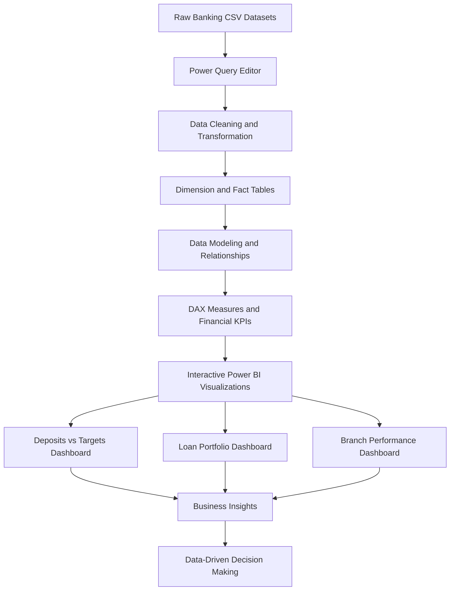

# 🏦 HDFC Bank — Banking Analytics & Business Intelligence Dashboard


> Transforming banking data into actionable financial intelligence through interactive dashboards, advanced analytics, and data-driven business insights.

---

## 📌 Project Overview

The HDFC Banking Analytics Dashboard is a comprehensive, three-page Business Intelligence project developed using Microsoft Power BI to analyze banking operations, deposit performance, loan portfolios, branch networks, and transaction activities.

The project combines data cleaning, data transformation, relational data modeling, DAX calculations, geographical analysis, and interactive data visualization to provide a consolidated view of banking performance.

The dashboard is designed to support financial performance monitoring, regional analysis, target achievement assessment, loan portfolio evaluation, and strategic business decision-making.

---


## 🎥 Project Presentation Video

Watch the complete HDFC Banking Analytics & Business Intelligence Dashboard presentation on YouTube.

[](https://youtu.be/je7TW8_J7Dg)

[▶ Watch Full Presentation on YouTube](https://youtu.be/je7TW8_J7Dg)

---


## 🎯 Business Objectives

- Monitor total deposits against allocated deposit targets.
- Analyze deposit achievement and year-over-year growth.
- Evaluate outstanding loan portfolios across products and regions.
- Monitor EMI collections and loan account distribution.
- Analyze branch-level operational performance.
- Identify the best-performing branches.
- Evaluate regional transaction activity.
- Understand geographical distribution of banking operations.
- Enable interactive financial analysis using dynamic filters.
- Provide meaningful business insights through automated DAX calculations.

---

## 📊 Executive KPI Summary

| Key Performance Indicator | Dashboard Value |
|---|---:|
| 💰 Total Deposits | ₹1,777.43 Cr |
| 🎯 Deposit Target | ₹49,321.03 Cr |
| 📈 Target Achievement | 3.6% |
| 🚀 YoY Deposit Growth | 50.1% |
| 🏦 Outstanding Loan Portfolio | ₹19,471.40 Cr |
| 👥 Loan Accounts | 77,775 |
| 💳 EMI Collection | ₹382.67 Cr |
| 💵 Average Outstanding per Account | ₹25,03,554.91 |
| 🏢 Total Branches | 500 |
| 🔄 Total Transactions | 5,00,000 |
| 💸 Average Transaction Value | ₹2,50,174.36 |
| 🏆 Best Performing Branch | HDFC Branch 62 |
| 📅 Reporting Date | 31-Dec-2025 |
| 📊 Interactive Dashboard Pages | 3 |

---

# 📈 Dashboard 1 — Deposits vs Targets


## Dashboard Overview

The Deposits vs Targets dashboard evaluates deposit performance against allocated banking targets and provides insights into deposit growth, regional contribution, product distribution, and branch-level performance.

### Key Performance Indicators

- Total Deposits
- Deposit Target
- Target Achievement Percentage
- Year-over-Year Deposit Growth

### Dashboard Visualizations

- Monthly Actual Deposits vs Targets
- Deposit Growth Trend
- Deposits by Product
- Geographic Deposit Distribution
- Deposit Performance by Branch Hierarchy
- Dynamic Key Insights

### Interactive Filters

- Financial Year
- Fiscal Quarter
- Year Month
- Region
- Zone
- Branch Name
- Product Name
- Clear Filters Button

### 💡 Key Business Insights

- Total deposits amount to approximately ₹1,777.43 crore.
- The dashboard reports an allocated deposit target of ₹49,321.03 crore.
- Current target achievement stands at approximately 3.6%.
- The reported deposit shortfall is approximately ₹47,543.60 crore.
- North Region leads deposit contribution.
- Deposits recorded year-over-year growth of 50.1%.
- Regional and branch-level drill-down enables detailed deposit performance investigation.

### Business Interpretation

The dashboard highlights positive year-over-year deposit growth alongside a significant reported gap between actual deposits and allocated targets.

Further investigation into target allocation, reporting periods, and deposit aggregation is recommended before drawing operational conclusions from the achievement percentage.

---

# 💳 Dashboard 2 — Loan Portfolio Breakdown


## Dashboard Overview

The Loan Portfolio dashboard provides a detailed analytical view of outstanding loan amounts, loan accounts, EMI collections, product-level exposure, and geographical lending performance.

### Key Performance Indicators

- Total Outstanding Loans
- Total Loan Accounts
- EMI Collection
- Average Outstanding Amount

### Dashboard Visualizations

- Outstanding Loan Portfolio by Product — Treemap
- Outstanding Loan Amount by Product
- Monthly EMI Collection Trend
- Geographic Loan Exposure
- Loan Accounts by Product
- Loan Portfolio Hierarchy Matrix
- Dynamic Key Insights

### Interactive Filters

- Financial Year
- Fiscal Quarter
- Region
- Zone
- Branch Name
- Product Name
- Clear Filters Button

### 💡 Key Business Insights

- The total outstanding portfolio amounts to approximately ₹19,471.40 crore.
- The dashboard reports 77,775 loan accounts.
- Total EMI collections amount to ₹382.67 crore.
- Average outstanding per account is approximately ₹25.04 lakh.
- Personal Loan leads the outstanding portfolio by product.
- North Region has the highest loan exposure.
- Product and geographical analysis enables identification of lending concentration across banking segments.

### Business Interpretation

The Loan Portfolio dashboard provides visibility into outstanding financial exposure, repayment collections, and product-level distribution.

These insights can support portfolio monitoring, collection planning, lending strategy, and regional performance evaluation.

The available product classifications include both lending and deposit-related labels. Product-to-loan mappings should be validated before interpreting the portfolio as an official lending report.

---

# 🏢 Dashboard 3 — Branch Performance


## Dashboard Overview

The Branch Performance dashboard evaluates the operational and financial performance of the banking network through transaction analysis, geographical distribution, regional comparisons, and branch-level scorecards.

### Key Performance Indicators

- Total Branches
- Total Transactions
- Average Transaction Value
- Best Performing Branch

### Dashboard Visualizations

- Geographic Branch Network Performance
- Transaction Value by Region
- Monthly Transaction Trend
- Transaction Type Distribution
- Regional Deposits and Outstanding Loans
- Branch Performance Scorecard
- Branch Ranking
- Dynamic Key Insights

### Interactive Filters

- Financial Year
- Fiscal Quarter
- Region
- Zone
- City
- Clear Filters Button

### 💡 Key Business Insights

- The banking network contains 500 branches.
- A total of 5,00,000 transactions are recorded.
- Average transaction value stands at ₹2,50,174.36.
- HDFC Branch 62 ranks as the best-performing branch based on the configured target achievement measure.
- North Region leads transaction activity.
- EMI represents the leading transaction type.
- Regional transaction values highlight differences in operational activity.
- Deposits recorded 50.1% year-over-year growth.

### Business Interpretation

The Branch Performance dashboard enables comparison of regional operations, transaction activity, and branch-level target achievement.

The hierarchical scorecard supports detailed investigation from regional performance to individual branch performance.

---

## 🛠️ Tools & Technologies

| Technology | Application |
|---|---|
| Microsoft Power BI Desktop | Dashboard Development |
| Power Query | Data Cleaning and Transformation |
| DAX | Business Metrics and Calculations |
| Data Modeling | Relational Data Architecture |
| CSV Datasets | Source Data |
| Geographic Map Visuals | Spatial Banking Analysis |
| Hierarchical Matrices | Branch-Level Drill-Down |
| GitHub | Project Documentation and Portfolio |

---

## 🗂️ Dataset Architecture

The project uses seven interconnected banking data tables.

| Table Name | Description |
|---|---|
| DimAccount | Customer Account Information |
| DimProduct | Banking Product Information |
| DimBranch | Branch, City, Zone and Regional Information |
| DimDate | Date and Financial Calendar Information |
| BranchDepositTargets | Branch-Level Deposit Targets |
| FactLoanRepayments | Loan Repayment and Outstanding Information |
| FactTransactions | Banking Transaction Records |

---

## 🧹 Data Cleaning & Transformation

Data preparation was performed using Power Query Editor to prepare structured and consistent datasets for financial analysis.

### Transformation Workflow

- Importing source CSV datasets
- Reviewing dataset quality
- Standardizing column names
- Configuring appropriate data types
- Preparing numerical and categorical fields
- Organizing date-related information
- Preparing dimension and fact tables
- Preserving Power Query Applied Steps
- Preparing datasets for relationship modeling
- Supporting geographical and hierarchical analysis

---

## 🔗 Data Modeling

The banking analytics model uses dimension and fact tables to support interactive financial reporting.

### Core Dimension Tables

- Account Dimension
- Product Dimension
- Branch Dimension
- Date Dimension

### Core Fact and Target Tables

- Transaction Facts
- Loan Repayment Facts
- Branch Deposit Targets

### Modeling Capabilities

- Relationship-based filtering
- Product-level financial analysis
- Branch and regional aggregation
- Date-based calculations
- Financial year analysis
- Quarter and month filtering
- Dynamic business KPIs
- Context-aware DAX measures

The dimensional modeling approach supports analytical reporting across deposit performance, lending operations, and branch activities.

---

## 🧮 DAX Measures & Business Calculations

DAX measures were developed to calculate financial performance indicators, dynamic insights, growth metrics, and operational KPIs.

### Deposit Analytics Measures

- Total Deposits
- Deposit Target
- Deposit Variance
- Target Achievement Percentage
- Previous Year Deposits
- YoY Deposit Growth

### Loan Analytics Measures

- Outstanding Loan Amount
- Total Loan Accounts
- EMI Collection
- Average Outstanding
- Outstanding Amount in Crores
- Leading Loan Product

### Branch Performance Measures

- Total Branches
- Total Transactions
- Total Transaction Value
- Average Transaction Value
- Branch Performance Rank
- Best Performing Branch
- Leading Transaction Region
- Leading Transaction Type

### Additional Calculations

- Dynamic Reporting Date
- Regional Performance Insights
- Product Performance Insights
- Context-Based Business Summaries

### Core Business Calculation Logic

**Target Achievement Percentage**

Achievement % = Total Deposits / Deposit Target × 100

**Deposit Variance**

Deposit Variance = Actual Deposits - Deposit Target

**Year-over-Year Deposit Growth**

YoY Growth % = (Current Year Deposits - Previous Year Deposits) / Previous Year Deposits × 100

**Average Outstanding Amount**

Average Outstanding = Total Outstanding Loan Amount / Total Loan Accounts

**Average Transaction Value**

Average Transaction Value = Total Transaction Value / Total Transactions

**Indian Currency Conversion**

Amount in Crores = Total Amount / 10,000,000

These formulas describe the business calculation logic used for analytical reporting.

---

## 🌐 Geographic Banking Analytics

Geographical visualizations provide insights into banking activity across different locations in India.

### Geographic Analysis Includes

- Deposit Distribution by City
- Outstanding Loan Exposure by City
- Branch Network Transaction Activity
- Regional Banking Performance
- Location-Based Financial Comparisons

The interactive maps allow users to explore geographical concentrations and regional differences in banking operations.

---

## 📅 Time Intelligence & Financial Analysis

The project incorporates date-based reporting to evaluate banking performance across different time periods.

### Time-Based Features

- Financial Year Analysis
- Fiscal Quarter Analysis
- Monthly Deposit Trends
- Monthly EMI Collection Trends
- Monthly Transaction Trends
- Previous Year Comparisons
- Year-over-Year Growth
- Dynamic Reporting Date

These capabilities support monitoring of financial performance over time.

---

## ⚙️ End-to-End Project Workflow



---

## 🎨 Dashboard Design & User Experience

The dashboard features a professional visual identity inspired by HDFC Bank's corporate branding.

### Design Highlights

- HDFC-inspired navy blue and red color palette
- Corporate-style header
- HDFC logo and branding
- Banking-themed sidebar illustration
- Custom financial KPI icons
- Consistent visual alignment
- Professional card-based dashboard layouts
- Interactive dropdown slicers
- Select All filtering options
- Functional Clear Filters buttons
- Three-page navigation
- Indian currency formatting
- Dynamic calendar and reporting date
- Geographical bubble maps
- Interactive financial matrices
- Dynamic Key Insights panels

---

## 🧭 Interactive Report Navigation

The dashboard contains three connected analytical pages.

| Page | Analytical Focus |
|---|---|
| Page 1 | Deposits and Target Achievement |
| Page 2 | Outstanding Loan Portfolio |
| Page 3 | Branch and Transaction Performance |

Users can navigate between dashboards using the custom sidebar navigation buttons.

The Clear Filters feature allows users to reset dashboard selections and return to the default analytical view.

---

## 💡 Strategic Business Recommendations

### 1. Investigate Deposit Target Achievement

Review branch-level deposit targets, reporting periods, and actual deposit aggregation to understand the reported achievement gap.

### 2. Strengthen High-Performing Regions

North Region leads multiple performance indicators. Analyze its operational practices to identify opportunities that may benefit other regions.

### 3. Improve Deposit Mobilization

Identify underperforming branches and evaluate targeted deposit campaigns, customer engagement, and product-level opportunities.

### 4. Monitor Outstanding Loan Exposure

Evaluate outstanding balances across regions and banking products to better understand portfolio concentration.

### 5. Strengthen EMI Collection Monitoring

Track EMI collection trends and repayment activity to support collection planning and portfolio management.

### 6. Optimize Branch Operations

Compare branch-level transaction activity, target achievement, and operational performance to identify improvement opportunities.

### 7. Enhance Geographic Banking Strategy

Use geographic analysis to evaluate differences in banking activity across cities and regions.

### 8. Benchmark High-Performing Branches

Study the performance of leading branches such as HDFC Branch 62 and investigate whether successful operational practices can be applied elsewhere.

---

## 🚀 Skills Demonstrated

- Business Intelligence
- Banking and Financial Analytics
- Data Analysis
- Data Cleaning
- Data Transformation
- Power Query
- Dimensional Data Modeling
- Relational Database Concepts
- DAX Calculations
- Financial KPI Development
- Time Intelligence
- Geographical Data Analysis
- Branch Performance Analytics
- Deposit Target Analysis
- Loan Portfolio Analysis
- Transaction Analysis
- Interactive Dashboard Development
- Data Visualization
- Business Storytelling
- Financial Performance Reporting
- GitHub Documentation

---

## 📁 Repository Structure

```text
HDFC_BANKING-ANALYTICS/
│
├── README.md
│
├── HDFC_BANKING_ANALYTICS_FINAL.pbix
│
├── DATASETS/
│   └── DATASETS.ZIP
│
└── ASSETS/
    ├── DEPOSITS VS TARGETS.png
    ├── LOAN PORTFOLIO.png
    └── BRANCH PERFOMANCE.png
```

---

## 📥 How to Use This Project

1. Clone or download this GitHub repository.
2. Install Microsoft Power BI Desktop.
3. Open the Power BI PBIX project file.
4. Explore the Deposits vs Targets dashboard.
5. Navigate to the Loan Portfolio dashboard.
6. Explore the Branch Performance dashboard.
7. Apply Financial Year, Quarter, Region, Zone and other available filters.
8. Use the Clear Filters button to reset selections.
9. Explore geographical maps and hierarchical matrices.
10. Analyze dynamic KPIs and business insights.

Refreshing the project may require access to the original CSV data sources and updated local file paths.

---

## 📋 Analytical Scope & Limitations

This project uses the available educational banking dataset.

The dashboard metrics represent calculations performed on that dataset and should not be interpreted as official HDFC Bank financial disclosures.

The dataset does not provide sufficient information for verified NPA ratios, official loan status classifications, or branch-type performance analysis. Therefore, the dashboard focuses on supported measures such as outstanding loan balances, EMI collections, deposits, transaction activity, and regional performance.

Deposit target aggregation and product-to-loan classifications should be independently validated before using the reported metrics for operational decisions.

---

## 🏆 Project Outcome

This project demonstrates the practical application of Microsoft Power BI in transforming banking transaction datasets into structured, interactive, and meaningful business intelligence.

By combining data preparation, relational modeling, financial DAX calculations, geographical analysis, hierarchical reporting, and professional dashboard development, the project delivers a comprehensive view of banking performance across three analytical dimensions:

- Deposit Performance and Target Achievement
- Loan Portfolio and Repayment Analytics
- Branch Operations and Transaction Performance

The project highlights the importance of data-driven analysis in understanding financial performance, identifying business opportunities, and supporting informed decision-making.

---

## 🔗 Project Repository

[View HDFC Banking Analytics Project on GitHub](https://github.com/raki265-official-ai/HDFC_BANKING-ANALYTICS)

---

## 📢 Disclaimer

This project was developed for educational, learning, and data analytics portfolio purposes.

It is not an official HDFC Bank dashboard and is not affiliated with or endorsed by HDFC Bank.

Brand names and logos are used for demonstration purposes only. All analytical results are based on the dataset used in this project.

---

## ⭐ Support

If you found this project insightful or useful, consider giving this repository a star.

---

<div align="center">

### 🏦 Turning Banking Data into Business Intelligence

**Data Analytics | Business Intelligence | Power BI | DAX | Financial Analytics**

🚀 Transforming Data into Insights. Transforming Insights into Decisions.

</div>


## ❇️AUTHOR

## PEDDURI RAKESH
